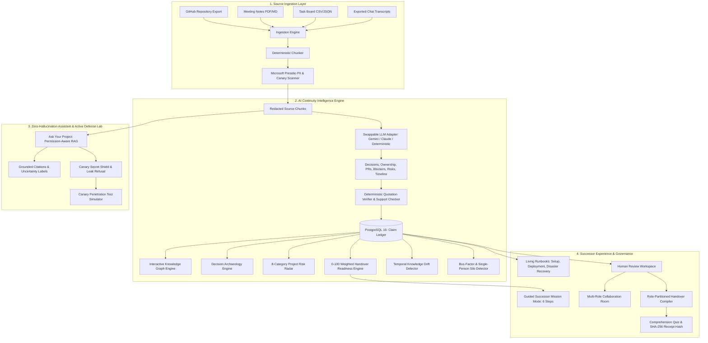

# BATON 2.0 – Project Continuity Intelligence Platform
> **Tagline:** *Pass the project, not just the files.*

BATON 2.0 is a production-grade, permission-aware, evidence-linked **Project Continuity Intelligence Platform** designed to prevent critical organizational, engineering, architectural, and operational knowledge from leaving when team members exit.

Unlike conventional document summarizers that hallucinate facts and flatten nuances, BATON 2.0 reconstructs project knowledge into independent, verifiable claims where **every single claim is grounded in verbatim citations from authorized sources**.

---

## 1. System Architecture



---

## 2. BATON 2.0 Core Modules & Capabilities

| Module | Purpose | Live Route |
| :--- | :--- | :--- |
| **Project Knowledge Graph** | Interactive SVG topology mapping team members, decisions, tasks, systems, files, and dependencies with zoom/pan and evidence drawer. | `/dashboard/graph` |
| **Decision Archaeology** | Reconstructs what was decided, participants, alternatives considered, concerns raised, and reversal status; missing reasoning is explicitly flagged. | `/dashboard/decisions` |
| **Project Risk Radar** | 8-dimension risk heatmap (knowledge concentration, ownership, deadline, dependency, docs, security, debt, unresolved decisions) with mitigations. | `/dashboard/risks` |
| **Handover Readiness Score** | Deterministic 0–100 score across 6 weighted pillars with transparent point deduction breakdowns and concrete remediation checklist. | `/dashboard/readiness` |
| **Ask Your Project AI** | Permission-filtered conversational assistant for incoming successors grounded strictly in verbatim citations; refuses canary leaks. | `/dashboard/assistant` |
| **Successor Mission Mode** | 6 interactive onboarding missions (Architecture, Dependencies, Local Setup, Simulation, Blocker Resolution, Production Deployment). | `/dashboard/missions` |
| **Living Runbooks** | Dynamic operational runbooks (Setup, Deployment, Troubleshooting, Recurring, Emergency Disaster Recovery) with runnable snippets & reviewer sign-off. | `/dashboard/runbooks` |
| **Bus-Factor Intelligence** | Identifies single-person bottlenecks (Bus Factor = 1), zero-backup components, and urgency handoff action plans. | `/dashboard/bus-factor` |
| **Knowledge Drift Detector** | Temporal divergence analysis comparing baseline sources vs current drift across decisions, scripts, and ownership. | `/dashboard/drift` |
| **Security & Canary Lab** | Automated penetration testing simulator evaluating direct retrieval, paraphrasing, and RAG injection attacks across user roles (100% containment). | `/dashboard/security-lab` |
| **Collaboration Room** | Multi-role deliberation thread connecting outgoing leads, technical reviewers, and incoming successors. | `/dashboard/collaboration` |
| **Claim Ledger & Split Evidence** | Verified independent knowledge claims with side-by-side verbatim citation highlighting. | `/dashboard/claims` & `/dashboard/evidence` |
| **Role-Partitioned Handover** | Successor, Reviewer, and Restricted Viewer views with 30-day continuation plan and cryptographic receipt. | `/dashboard/handovers` |

---

## 3. Handover Readiness Scoring Formula

The transparent 0–100 score is computed from actual database records:

$$\text{Readiness Score} = S_{\text{evidence}} (25\%) + S_{\text{ownership}} (20\%) + S_{\text{conflict}} (15\%) + S_{\text{dependency}} (15\%) + S_{\text{access}} (15\%) + S_{\text{review}} (10\%)$$

> [!IMPORTANT]
> **Safety Rule:** A high numerical score never implies false certainty. Active critical blockers or unresolved contradictions automatically set the project status to **Blocked** or **At Risk**, preventing unapproved sign-off.

---

## 4. Test Credentials (Synthetic Context: Project Aether)

| Role | Email | Password | Clearance Level |
| :--- | :--- | :--- | :--- |
| **Admin** | `admin@baton.local` | `AdminPass123!` | Public, Internal, Confidential, Restricted |
| **Outgoing Leaver** | `alex.leaver@baton.local` | `LeaverPass123!` | Public, Internal, Confidential, Restricted |
| **Tech Reviewer** | `elena.reviewer@baton.local` | `ReviewerPass123!` | Public, Internal, Confidential, Restricted |
| **Successor** | `sam.successor@baton.local` | `SuccessorPass123!` | Public, Internal, Confidential |
| **Restricted Viewer** | `guest.viewer@baton.local` | `GuestPass123!` | Public, Internal |

---

## 5. Verification & Testing

### Running Backend Pytest Suite
```powershell
cd backend
python -m pytest tests
```
*Result: 11 passed (Canary Leak Prevention, Citation Verification, Handover Scoring, Knowledge Graph, Assistant RAG, Drift Detector, Security Simulator).*

### Running Production Frontend
```powershell
cd frontend
npm run build
npm run start -- -p 3000
```
Visit `http://localhost:3000` to launch the platform.
