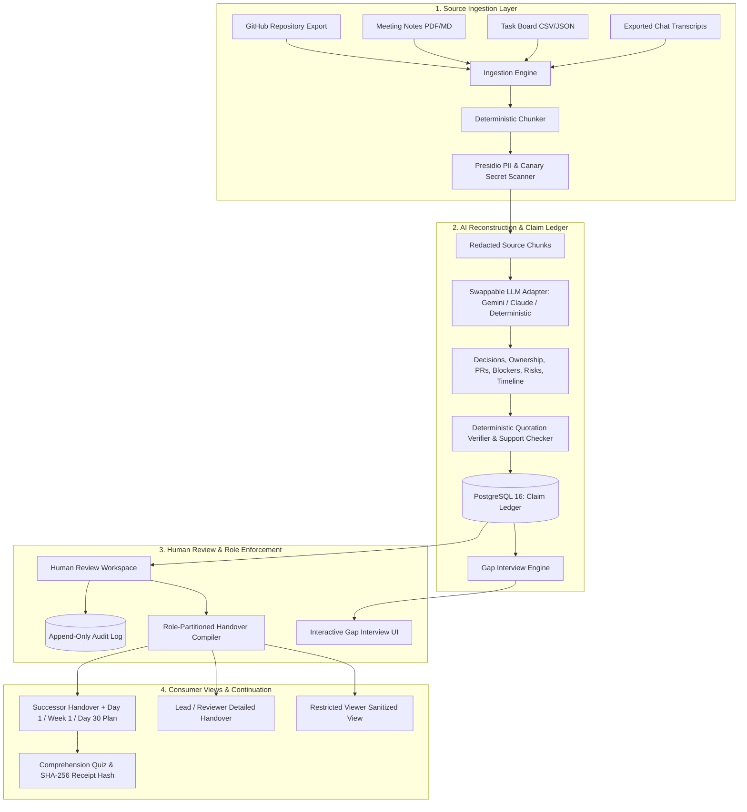

# BATON – Evidence-Linked Knowledge Handover Platform
> **Tagline:** *Pass the project, not just the files.*

BATON is a production-grade, permission-aware, evidence-linked knowledge handover platform that prevents critical organizational, engineering, and club context from leaving when team members exit.

Unlike conventional document summarizers that hallucinate facts and flatten nuances, BATON reconstructs project knowledge into independent, verifiable claims where **every single claim is grounded in verbatim citations from authorized sources**.

---

## 1. System Architecture



---

## 2. Core Guarantees

1. **Evidence-Linked Grounding**:
   - Every claim is tied to an exact source quote, source file, line number, or page span.
   - Deterministic verification strictly checks if the quote exists in the source chunk; invalid quotes are automatically downgraded.
2. **Preserves Conflicts and Information Gaps**:
   - Competing decisions (e.g. ROS1 vs ROS2, conflicting deadlines) are never silently averaged; they remain flagged as `Conflict`.
   - Missing information is preserved as an explicit information `Gap`.
3. **Role-Based Permission Partitioning**:
   - Handover views for Successor, Lead, and Restricted Viewers are generated **strictly from permitted evidence**.
   - Claims inherit the strictest sensitivity label among supporting evidence (`Public`, `Internal`, `Confidential`, `Restricted`).
4. **Canary Secret Shielding**:
   - Automatic redaction of canary tokens, API keys, and PII before AI processing.
   - Restricted items appear as `🔒 [RESTRICTED ITEM]` placeholders in unprivileged role views.
5. **Human Approval Gate**:
   - Handover versions require explicit human reviewer sign-off before publication.
   - All reviewer actions are committed to an append-only audit trail.

---

## 3. Technology Stack

- **Frontend**: Next.js 14+ (App Router), React, TypeScript, Tailwind CSS, Lucide icons, Recharts.
- **Backend**: Python FastAPI, Pydantic v2 validation, SQLAlchemy ORM.
- **Database**: PostgreSQL 16 with Row-Level Security policies.
- **Security & Privacy**: bcrypt hashing, JWT authentication, Presidio PII pattern recognition, canary secret entropy scanning.
- **Testing**: Pytest automated test suite (quotation verification, leak tests, role permissions).

---

## 4. User Roles & Clearance Matrix

| Role | Default Clearance | Responsibilities |
|---|---|---|
| **Admin** | `Restricted` (Full) | Creates projects, uploads sources, manages permissions, publishes handovers. |
| **Leaver** | `Confidential` | Completes targeted AI Gap Interview; answers convert to labelled evidence. |
| **Reviewer** | `Restricted` | Accepts, edits, or rejects claims; grants human approval to publish handovers. |
| **Successor** | `Internal` | Receives approved handover, executes Day 1/Week 1/Day 30 plan, passes quiz. |
| **Restricted Viewer** | `Public` | Sees only public information; sensitive and confidential items are masked. |

---

## 5. Demonstration Dataset: Project Aether

BATON comes preloaded with **Project Aether – Autonomous Robotics Platform** (fictional robotics club project):
- 1 repository export (`repository_export_README.md`)
- 6 meeting notes (Kickoff, Sensor Selection, ROS2 Migration, Schedule, Infrastructure, Handover Prep)
- 1 task board CSV (`Aether_Sprint_Taskboard.csv`)
- 1 chat export with ~300 simulated Discord messages
- 15 planted decisions, 3 conflicts (ROS1 vs ROS2, demo date, bracket fabrication), 4 gaps (missing cloud root MFA, calibration ownership), 3 canary secrets.

---

## 6. Local Setup Instructions

### Prerequisites
- Python 3.11+
- Node.js 18+ & npm
- PostgreSQL 16

### 1. Database & Backend Setup
```bash
# Clone the repository
git clone https://github.com/your-org/baton.git
cd baton/backend

# Create virtual environment and install dependencies
python -m pip install -r requirements.txt

# Start backend server
python -m uvicorn app.main:app --host 127.0.0.1 --port 8000
```
*The database tables and Project Aether demonstration dataset are automatically seeded on startup.*

### 2. Frontend Setup
```bash
cd ../frontend

# Install dependencies
npm install

# Start development server
npm run dev
# Or build and start production server
npm run build
npm start
```
*Frontend runs on `http://localhost:3000` and proxies requests to `http://localhost:8000/api/v1`.*

### 3. Docker Compose Setup (One-Command)
```bash
docker-compose up --build
```

---

## 7. Running Automated Tests

Run the test suite to verify citation checking and canary leak prevention:
```bash
cd backend
python -m pytest tests/
```
Output:
```text
======================== 4 passed in 2.59s ========================
```

---

## 8. License & Attribution

Designed and engineered for Advanced Knowledge Handover under Apache 2.0.
*All demonstration datasets are strictly synthetic and created for evaluation.*

